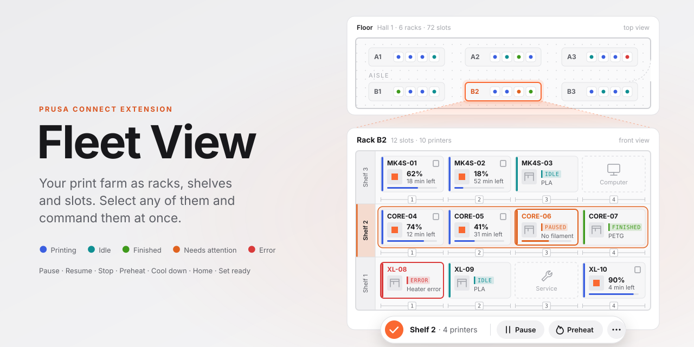

<!-- The banner is HTML because a Markdown image cannot follow the reader's theme. -->
<!-- rumdl-disable MD033 MD041 -->
<picture>
  <source media="(prefers-color-scheme: dark)" srcset="docs/hero-dark.svg">
  <source media="(prefers-color-scheme: light)" srcset="docs/hero-light.svg">
  
</picture>
<!-- rumdl-enable MD033 -->

# Fleet View

An extension for [Prusa Connect](https://github.com/prusa3d/prusa-connect) that shows a print farm the way it stands
in the room: racks on a floor plan, shelves in each rack, a printer in each slot with its live state. Select a whole
rack, one shelf or one printer and send them a command at once.

## What it does

- **Floor plan.** Every rack on a grid, with a dot per slot coloured by the printer's state. Double-click a rack to
  open it.
- **Rack front view.** Shelves top to bottom, each slot a tile with the printer's name, state and print progress.
  Computer and service placeholders keep a slot free of printers.
- **Batch commands.** Select a rack, a shelf or a printer and pause, resume, stop, set ready, preheat, cool down or
  home all of them.
- **Edit mode.** Add and name racks and shelves, then drag printers or placeholders onto slots, on the floor or in a
  rack. A click works where a drag does not.
- **One layout for everyone.** The layout is kept on the server, so every person sees the same floor. A save over a
  change someone else made is refused and offered back, never overwritten unseen.
- **YAML import and export.** Write the layout by hand, or keep it in version control.
- **Rack card.** One rack's front view on a dashboard, with the same selection and commands.

## Requirements

- Prusa Connect `0.1.0-beta.1` or newer.
- A data directory for the module. It asks for one in `module.yaml` (`needs: data: true`) and keeps the layout in it
  as `layout.json`.

The module connects nowhere outside Prusa Connect, and acts only for the person signed in: it has no permissions of
its own and does no background work.

## Installing

From a release directory:

```bash
prusa-connect module add github.com/jakubdotpy/connect-fleet-view@0.1.0 -from <release directory> -approve
```

Then open **Fleet View** in the sidebar. To put a rack on a dashboard, edit the dashboard, choose **Add a card**, pick
**Rack** under Fleet View and choose the rack.

## The layout file

**Edit layout** exports and imports the layout as YAML. Racks are matched by name, so an import keeps the dashboard
cards that show them. A printer is matched by its name or serial; one this server does not know leaves its slot
empty and is listed after the import.

```yaml
version: 1
units:
  - name: R1
    at: [ 0, 0 ]          # grid cell of the top-left corner; left out, the first free spot
    shelves:              # top shelf first, as a rack is read
      - name: Top
        slots:
          - { name: A1, printer: MK4S-01 }
          - { name: A2, serial: CZPX1234X004XC12345 }
          - { name: A3, placeholder: computer }
      - name: Bottom
        slots:
          - { name: B1, placeholder: service }
          - { name: B2 }
```

## Routes

Under `/api/v1/modules/com.github.aux.jakubdotpy.connect-fleet-view/`, described in `openapi.json`:

| route | does |
| --- | --- |
| `GET /layout` | the shared layout and its version; version 0 and a null layout before the first save |
| `PUT /layout` | saves `{version, layout}` over the version read; an older version is refused with `LAYOUT_CHANGED` |

Every refusal carries a code from `faults.go`.

## Building from source

The Go SDK and the `@prusa` packages are not published yet, so `make` clones the pinned Prusa Connect release into
`.core/` and builds against it. It needs Go, Node 22 and pnpm 11.

```bash
make check      # go vet, go test, lint, format and type checks, the bundle
make release    # every platform in module.yaml into release/
make install    # release/ into a scratch core under bin/try, and how to start it
```

Pushing a GitHub release publishes it to the Prusa Plugin Marketplace through `.github/workflows/release.yml`.

## Licence

MIT, see [LICENSE](LICENSE).
